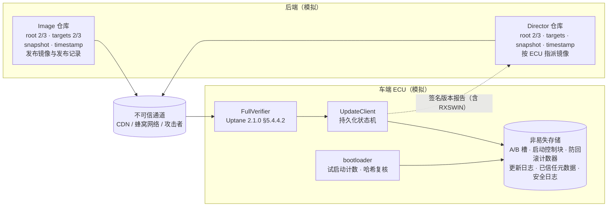

# 车端安全升级（secure_update）

> 个人项目，使用 AI 工具辅助完成。
>
> **Uptane-inspired, not a conformant implementation**：参照 Uptane Standard 2.1.0 设计，不是符合性实现（差异见第 7 节）。
>
> 数据全部是合成的；密钥只在测试或演示运行时于内存中生成，不写盘、不提交。

## 1. 做了什么，为什么

P3 前面的部分都在车队和后端这一侧：法规清单、发布闸门、资格筛选、分批推送、故障注入。车端只模拟了结果，`02_升级活动规划设计.md` 第 9 节局限 3 写明“验签、哈希核对、回滚、回读校验都按概率给出结果……A/B 分区本身……密码学运算都没有实现”。

这个目录把车端补成能运行、能测试的代码：

1. **参照 Uptane 的元数据与校验**：Director 和 Image 两个仓库，各有 root、targets、snapshot、timestamp 四个角色。元数据是确定性 JSON，用 Ed25519 签名（调用 `cryptography` 库）。车端检查签名门限、过期时间、版本号、镜像 SHA-256 和长度、硬件标识，并支持 root 密钥轮换。
2. **A/B 槽位的 ECU 更新客户端**：下载到非活动槽 → 读回校验 → 写槽头 → 标记 pending → 重启试运行 → 健康检查（或试启动次数用完）→ 提交，或者自动回滚。有一个独立于软件版本号的防回滚计数器。软件标识和 RXSWIN 记录与 active 槽在同一次原子写入里切换。
3. **攻击与故障测试**：38 个测试函数覆盖元数据攻击、镜像攻击、密钥攻击和设备故障。每个测试都映射到 R155 附件5 的威胁和缓解编号（已对照官方文本），以及 P3 的 TARA、控制点和需求编号，见 `traceability_secure_update.csv`。

## 2. 架构



单次升级的状态机（`client.py`）：

```
IDLE ─▶ DOWNLOADING ─▶ DOWNLOADED ─▶ READY ─▶ 标记 pending（试启动 3 次）─▶ 重启 ─▶ 试运行
                                                                                  │
   ┌──────────────────────────────────────────────────────────────────────────────┤
   ├─ 健康检查 OK   ─▶ 提交：active 切到新槽 + 软件标识 / RXSWIN（一次原子写入）─▶ 计数器提升 ─▶ IDLE（COMMITTED）
   ├─ 健康检查 FAIL ─▶ 清除 pending ─▶ 重启回旧槽 ─────────────────────────────────▶ IDLE（ROLLED_BACK）
   └─ 新镜像崩溃    ─▶ 看门狗复位；次数用完后 bootloader 自动清除 pending ─────────▶ IDLE（ROLLED_BACK）
```

| 模块 | 作用 |
|---|---|
| `canonical.py` | 确定性 JSON：键排序、无空白、UTF-8、拒绝浮点数、字符串必须是 NFC；严格解析时拒绝重复键和 NaN |
| `crypto.py` | Ed25519 签名与验签，全部调用 `cryptography`；keyid = 公钥描述的 SHA-256 |
| `metadata.py` | 签名信封、门限验签（同一把钥匙只算一次）、各角色的结构检查 |
| `repository.py` | 后端模拟：两个仓库签发元数据、轮换密钥；后端核对 ECU 版本报告 |
| `transport.py` | 不可信通道；测试在这里替换、丢弃文件，或者灌入读不完的数据 |
| `verifier.py` | 车端 full verification：root 逐版本轮换 → timestamp → snapshot → targets → Director 与 Image 仓库逐项比对 |
| `nvstore.py` | 非易失存储与断电注入（可模拟撕裂写入）；单份带校验的记录、双份带序号的原子记录 |
| `ecu.py` | A/B 槽、启动控制块、防回滚计数器、bootloader、软件标识读取、签名版本报告 |
| `client.py` | 更新客户端状态机：每一步只写一次、可以重复执行，断电后从存储里的状态接着走 |
| `testbed.py` | 测试和演示共用的场景搭建、攻击者用的签名工具、断电扫描 |
| `demo.py` | `python -m secure_update.demo` 终端演示 |

## 3. 怎么运行

在 **P3 根目录** 运行（不是在 `secure_update/` 里）。代码按 Python 3.10+ 写，依赖 `cryptography` 和 `pytest`；本机用 Python 3.13.14、cryptography 49.0.0、pytest 9.1.1 测试。Windows 终端如果中文乱码，先执行 `$env:PYTHONIOENCODING="utf-8"`。

```bash
python -m pytest tests secure_update          # P3 原有 72 个 + 本目录 55 个 = 127 passed
python -m secure_update.demo                  # 终端演示：正常升级、14 个攻击、设备故障、断电扫描
python -m secure_update.demo --out <目录>      # 另外写出 attack_results.csv 和 power_cut_sweep.csv
```

注意：P3 的 `pytest.ini` 写的是 `testpaths = tests`，所以不带参数的 `python -m pytest` 仍然只跑原来的 72 个。要让它默认包含本目录，需要把那一行改成 `testpaths = tests secure_update/tests`。本目录不改 P3 的任何文件，所以这一改动留给主项目决定。

## 4. 设计要点

### 4.1 四个角色、两个仓库

| 角色 | 签什么（Uptane 2.1.0） | 本项目的设置（演示值） |
|---|---|---|
| root | Root 元数据：四个角色的公钥、每个角色的公钥和签名门限，也分发密钥的撤销（§5.1.1、§5.2.2） | 两个仓库都是 3 把钥匙、门限 2；有效期 365 天 |
| targets | 镜像和委派的元数据（§5.1.2）：文件名、字节数、哈希（§5.2.3.1），以及自定义元数据（§5.2.3.1.1） | Image 仓库 3 把钥匙、门限 2；Director 1 把；30 天 |
| snapshot | 仓库发布的全部 targets 元数据的文件名和版本号（§5.1.3、§5.2.4） | 1 把；7 天 |
| timestamp | 最新 snapshot 的版本号和哈希，表明有没有新内容（§5.1.4、§5.2.5） | 1 把；1 天 |

- **Image 仓库**主要由人工控制、更新不频繁；**Director** 主要由自动化在线流程控制，按需生成签名元数据，指示每个 ECU 装哪个镜像（§5.3.1、§5.3.2）。本项目把 Director 的 targets 门限设为 1、Image 仓库的 targets 设为 2/3，这是设计选择：Uptane 2.1.0 这两节没有规定密钥怎么存放。
- **两个仓库交叉核对**（§5.4.4.2 steps 10–12）：Director 指派的镜像必须出现在 Image 仓库签名的 targets 里，长度、哈希、硬件标识、release counter 都要一致。本项目另外要求 RXSWIN 一致。所以只攻破在线的 Director 不足以让车装上任意软件（测试 SU-K08）。
- **Director 专属检查**（§5.4.4.6 steps 6–8）：不能有委派；同一个 ECU 标识不能出现两次；本 ECU 充当 Primary，要核对 Director 列出的 ECU 确实在车上。

### 4.2 车端校验顺序

`FullVerifier.verify()` 按 §5.4.4.2 的步骤走，各函数注释里标了步骤号：

1. root（§5.4.4.3）：逐个下载 N+1 版，新 root 必须**同时**满足旧 root 和新 root 的门限，版本只能 +1，最后检查没有过期。如果 timestamp 或 snapshot 的密钥被轮换，就删掉旧的 timestamp 和 snapshot，以便从快进攻击中恢复。
2. timestamp（§5.4.4.4）：门限、版本不倒退、没过期（过期就报可能的 freeze attack）。
3. snapshot（§5.4.4.5）：哈希和版本要与 timestamp 一致、门限、版本不倒退、各 targets 版本不倒退且不消失、没过期。
4. targets（§5.4.4.6）：版本要与 snapshot 一致、门限、不倒退、没过期，以及 Director 专属检查。

   §5.4.4.5 和 §5.4.4.6 给每种失败都标了攻击类型：与上一级对不上 → mix-and-match，签名门限不够 → arbitrary software，版本倒退 → rollback，过期 → freeze。`errors.py` 的异常标签与之一致。
5. 先 Director，再 Image 仓库，最后逐项比对。每一步失败都抛出带攻击类型的异常（§5.4.4.2：SHOULD 返回能指明攻击类型的错误码），并写入车端安全日志。
6. 每次下载都有字节上限（§5.4.4.3–§5.4.4.6 的 X、Y、Z 由实现方自定；snapshot 的上限取 timestamp 里写明的长度），镜像最多读到签名里写的长度（§5.4.3.3）。

### 4.3 四种“版本”，各防什么

| 名称 | 在哪里 | 防什么 | 测试 |
|---|---|---|---|
| 元数据版本号 | 每份元数据的 `version` | 重放旧元数据（rollback、freeze） | SU-M02、SU-K06 |
| release counter | 镜像自定义元数据（§5.2.3.1.1，SHOULD） | Director 把车指回旧发布（§5.4.3.4 step 5：不能低于之前的） | SU-A04 |
| secure_version + 防回滚计数器 | 镜像发布记录 + ECU 硬件计数器（本项目的设计，不是 Uptane 字段） | 已修复漏洞的旧代码，即使签名有效、即使被正式重新发布 | SU-A01、SU-A02 |
| 软件版本号（如 1.6.0） | 发布记录、软件标识 | 不防攻击：给人看的标识，与 RXSWIN 一起记录 | SU-A03 |

要回退，就让 Image 仓库重新发布旧代码（新的 release counter，同样的 secure_version）。这对应 P3 TARA 中 CG3 的“单独授权的回退除外”，也对应 02 文档 5.4 节的“推送旧版本当作一次新的升级活动”。计数器**只在提交之后**才提升，所以试运行失败时旧槽仍然能启动；提交以后，旧镜像会被计数器挡住。

### 4.4 A/B 客户端与断电

- 一次升级会话共 18 次持久化写入（`python -m secure_update.demo` 会逐条列出）。每一步只写一次、可以重复执行；下载只写非活动槽；active 槽只在“提交”那一次原子写入里切换。所以**任何时刻 active 槽都能启动**。
- 启动控制块、更新日志、计数器都用“两份副本 + 序号”存放：每次覆盖较旧的那份，撕裂写入只会毁掉正在写的那份，读到的要么是旧值，要么是新值。槽头用单份加 SHA-256 校验，撕裂就等于无效。
- bootloader 先把试启动次数减一并写回，然后才跳转。新镜像反复崩溃时，次数会耗尽，bootloader 自动回滚。bootloader 还会重算槽内镜像的哈希，校验之后被改过的槽不启动（SU-D05）。
- Uptane 2.1.0 §5.4.3.3 写明 ECU SHOULD 先备份之前可用的镜像；§5.4.3.5 把“有当前镜像和元数据的备份，以防安装失败”列为安装的前提之一。A/B 的旧槽就是这样的备份。
- 断电扫描：在 18 个写入点逐一断电，覆盖撕裂写入 / 干净断电 × 健康检查通过 / 失败（失败路径是 17 个写入点）。恢复途中再断一次电共 179 种组合。断电那一刻要求 active 槽可启动、版本与 RXSWIN 成对；重新上电后，结局必须与不断电时相同，并且不变量全部成立（`testbed.check_invariants`）。
- 每次会话都重新做完整的元数据校验，包括断点续传和激活之前。Director 撤回指派（对应 P3 的 HALT）后，未完成的下载会被丢弃（SU-C01）。先决条件不满足或者联网确认不了时，不激活，下载保留（SU-C03）。

### 4.5 软件标识 / RXSWIN 与 R156

RXSWIN 的定义：车企定义的专用标识，代表对 R-X 型式批准相关特性有贡献的电控系统中“型式批准相关软件”的信息（R156 2.2）。01 系列新增的 7.1.1.3 要求对每个要执行软件升级的 R-X 型式批准分配专用 RXSWIN，所以每个相关的 UN 法规 X 各有一个。本项目每个 ECU 只记录一个 RXSWIN 字段，取值沿用 P3 活动配置中 MODEL_A 的登记册（1.5.0 → A-RX-06，1.6.0 → A-RX-07）。下表的条款都已列在 P3 的需求清单里；括号内是 01 系列的编号。

| R156 条款 | 要求（概述） | 代码里怎么做 | 测试 |
|---|---|---|---|
| 7.2.1.2.1 | RXSWIN 唯一；型式批准相关软件修改导致扩展或新批准时须更新 | 车端不判断是否涉及型式批准：RXSWIN 来自 Image 仓库签名的发布记录（由车企的 SUMS 决定），提交时与 active 槽原子切换；不涉及型式批准的 1.5.1 保持 A-RX-06 | SU-D01、SU-A03、SU-D02 |
| 7.2.1.2.2 | 经电子通信接口，至少经 OBD 口以标准化方式读取 | `read_software_identification()` 模拟诊断读取：返回已提交的记录；试运行期间另给出 trial | SU-R01 |
| 7.2.1.2.3 | 防止 RXSWIN 和软件版本被未授权修改 | 只有提交这一条路径会写这条记录；版本报告用 ECU 身份密钥签名，篡改后验签失败 | SU-R02、SU-D02 |
| 7.1.1.3（7.1.1.4） | 升级前后的 RXSWIN 信息可访问、可更新，含各软件的版本和完整性验证数据 | 签名版本报告带镜像哈希、软件版本和 RXSWIN，升级前后各报一次 | SU-R02 |
| 7.1.1.4（7.1.1.5） | 车企能核验部件上的软件版本与 RXSWIN 的定义一致 | 后端验签核对版本报告；车端拒绝 RXSWIN 与发布记录不一致的指派 | SU-R02、SU-R03 |
| 7.1.2.3 | 每个 RXSWIN 有可审核的登记册 | 版本报告是登记册的车端证据；登记册本身在后端（P3 C13、C17） | SU-R02 |
| 7.2.2.1.1 | 升级失败或中断时，恢复先前版本或进入安全状态 | A/B 回滚；任何断电点都能回到某个已校验的版本 | SU-D02 至 SU-D06 |
| 7.2.2.1.2、7.2.2.5 | 电量足够才执行；执行前满足先决条件 | 激活前调用先决条件钩子（阈值在 P3 的 `ota_plan.py` 里），不满足就不激活 | SU-C03 |

## 5. 测试 → 威胁对照

完整的 12 列映射（包括 P3 需求编号和备注）见 `traceability_secure_update.csv`。`test_su_traceability.py` 会检查：每个编号都确实存在于 P3 的 `01_requirements_checklist.csv`、`02_traceability_matrix.csv`、`03_tara.csv` 里；R155 的缓解编号与附件5 Part B 的对应关系一致；引用的 Uptane 小节都在已核对的列表里；测试函数与表格行一一对应。

| ID | 场景 | Uptane 2.1.0 | R155 附件5（威胁 → 缓解） | P3 TARA | P3 控制点 |
|---|---|---|---|---|---|
| SU-B01 | 确定性序列化、严格解析 | 5.2 | — | — | C12 |
| SU-B02 | Ed25519（cryptography 库） | 5.2.1、5.2.2 | 26.2 → M23 | TS1、CG1 | C12 |
| SU-M01 | freeze：旧 timestamp 一直重放到过期 | 4.3.2；5.4.4.4 | 6.3、13.1 → M10、M3 | TS4、DS3、CG4 | C23、C18 |
| SU-M02 | rollback：旧 timestamp / snapshot / targets | 4.3.3；5.4.4.4–5.4.4.5 | 6.3、12.1 → M10、M16 | TS3、DS6、CG3 | C22、C12 |
| SU-M03 | mix-and-match：snapshot 与 targets / timestamp 对不上 | 4.3.3；5.4.4.5–5.4.4.6 | 12.1 → M16 | TS1、CG1 | C12 |
| SU-M04 | Director 与 Image 仓库的哈希不一致 | 5.4.4.2 | 12.1 → M16 | TS1、TS5 | C12、C19 |
| SU-M05 | 过期：Image targets、Director targets、root | 5.4.4.3、5.4.4.5、5.4.4.6 | 6.3、12.1 → M10、M16 | TS3、TS4 | C12、C22 |
| SU-M06 | endless data：timestamp 读不完 | 4.3.3；5.4.4.4 | 8.1 → M13 | TS1、DS2 | C12 |
| SU-I01 | 镜像被篡改（长度不变） | 4.3.4；5.4.3.4 | 5.1、12.1、12.3 → M6、M10、M16 | TS1、DS1、CG1 | C19、C12 |
| SU-I02 | 改了元数据里的哈希、保留原签名 | 4.3.4；5.4.4.6 | 5.1、12.1 → M6、M10、M16 | TS1、CG1 | C12 |
| SU-I03 | endless data：镜像后面追加垃圾数据 | 4.3.3；5.4.3.3 | 8.1 → M13 | TS1、DS2 | C19 |
| SU-I04 | 声明长度超过槽位容量 | 4.3.3；5.4.3.3 | 8.1 → M13 | TS1、DS2 | C19 |
| SU-I05 | wrong ECU：硬件标识不符 | 5.2.3.1.1；5.4.3.4；5.4.4.2 | 12.1 → M16 | TS5、DS2、CG5 | C02 |
| SU-I06 | Director 指向不存在或重复的 ECU | 5.4.4.6 | 12.1 → M16 | TS5、CG5 | C01、C02 |
| SU-K01 | 门限不足（有效签名 1 个，门限 2） | 5.2.2；5.4.4.6 | 12.4 → M11 | TS2、CG2 | C20、C12 |
| SU-K02 | 复制同一个签名凑门限 | 5.4.4.4；5.4.4.6 | 12.4 → M11 | TS2、CG2 | C20 |
| SU-K03 | 用其他角色的密钥补签 | 5.2.2；5.4.4.6 | 12.4 → M11 | TS2、CG2 | C20 |
| SU-K04 | 轮换之后用已撤销的旧密钥 | 5.2.2；5.4.4.3 | 12.4、19.3 → M11 | TS2、CG2 | C20 |
| SU-K05 | root 轮换缺新门限或旧门限 | 5.4.4.3 | 12.4 → M11 | TS2、CG2 | C20 |
| SU-K06 | root 重放、版本跳号 | 5.4.4.3 | 6.3、12.4 → M10、M11 | TS2、TS3 | C20、C22 |
| SU-K07 | timestamp 被快进，轮换密钥后恢复 | 5.4.4.3 | 12.4 → M11 | TS2、CG2 | C20 |
| SU-K08 | Director 密钥被盗，指派未发布的镜像 | 4.3.4；5.4.4.2 | 12.1、12.4 → M16、M11 | TS1、TS2、CG1 | C12、C20 |
| SU-D01 | 正常升级（正向对照） | 5.4.4.2；5.4.3.4–5.4.3.6 | 12.1 → M16 | TS1、CG1 | C10、C12、C17、C19 |
| SU-D02 | 每一次写入处断电（4 种组合） | 5.4.4；5.4.3.5；3.3 | —（不是网络攻击） | DS2 | C10、C26 |
| SU-D03 | 恢复途中再断一次电 | 5.4.4；5.4.3.5 | — | DS2 | C10、C26 |
| SU-D04 | 健康检查失败 → 回滚 | 5.4.3.5 | — | DS2 | C10、C11 |
| SU-D05 | 校验后槽内容被改，bootloader 拒绝启动 | 3.4；5.4.3.5 | — | TS8、CG8、DS1 | C26 |
| SU-D06 | 新镜像反复崩溃，试启动次数用完后回滚 | 5.4.3.5；5.4.4 | — | DS2 | C10 |
| SU-A01 | 计数器只在提交之后提升 | 4.3.3 | 6.3 → M10 | TS3、DS6、CG3 | C22 |
| SU-A02 | 正式重发的旧代码被硬件下限挡住 | 4.3.3 | 6.3 → M10 | TS3、DS6、CG3 | C22 |
| SU-A03 | 同一安全等级内的授权回退 | 5.2.3.1.1 | 6.3 → M10 | TS3、CG3 | C22 |
| SU-A04 | release counter 倒退 | 5.2.3.1.1；5.4.3.4；5.4.4.2 | 6.3、12.4 → M10、M11 | TS2、TS3、CG3 | C22 |
| SU-C01 | 活动被叫停，丢弃未完成的下载 | 5.4.4.2 | — | — | C14、C07 |
| SU-C02 | 断点续传之前重新校验元数据 | 5.4.3.3；5.4.4.2 | 6.2 → M10 | TS1、CG1 | C21 |
| SU-C03 | 电量或网络不满足时不激活 | 3.3 | — | — | C07、C08 |
| SU-R01 | 试运行期间读取软件标识 | — | — | TS7、DS5、CG7 | C17 |
| SU-R02 | 签名版本报告（含 RXSWIN） | 5.4.1；5.4.2.1.2 | — | TS5、TS7、CG5、CG7 | C17、C03、C18 |
| SU-R03 | RXSWIN 与发布记录不一致 | 5.4.4.2 | 12.1 → M16 | TS5、DS5、CG5 | C03、C17 |

说明：

- R155 附件5 的原表有合并单元格：6.2 与 6.3 共用 M10（表 B1），12.1–12.3 共用 M16（表 B2），26.1–26.3 共用 M23（表 B6）。上表的“威胁 → 缓解”按原表对应。
- 断电、健康检查失败不属于网络攻击，R155 附件5 没有对应条目，所以标“—”。它们对应 R156 7.2.2.1.1、GB 44496 5.2.9，以及 P3 TARA 中的损害场景 DS2。
- 另有 3 个测试不映射到威胁：追溯表自检、仓库卫生检查（没有私钥、没有绝对路径）、演示脚本冒烟测试。

## 6. 来源（访问日期 2026-10-27）

| 来源 | 用到的部分 |
|---|---|
| Uptane Standard for Design and Implementation **2.1.0**（uptane.org/docs/latest/standard/uptane-standard，页面标注 Latest 2.1.0） | §2.1（符合性要求遵守全部规则）、§3.3、§3.4、§4.3.2–§4.3.4（freeze、rollback、endless data、mix-and-match、arbitrary software 的定义）、§5.1–§5.1.4、§5.1.2.1、§5.2（格式不强制；字符串 RFC 5198 + NFC）、§5.2.1–§5.2.5、§5.2.3.1.1、§5.2.7、§5.3.1、§5.3.2、§5.4（SHALL 有安全时间源）、§5.4.1、§5.4.2.1.2、§5.4.3.3–§5.4.3.6、§5.4.4（错误 SHOULD NOT 让 ECU 不可恢复）、§5.4.4.1–§5.4.4.6 |
| UN R155，ECE/TRANS/WP.29/2020/79（2020-04-02，即 P3 的 S4） | 附件5 Part A 表 A1：5.1、6.2、6.3、8.1、12.1、12.3、12.4、13.1、19.3、26.2；Part B 表 B1、B2、B5、B6 的威胁 → 缓解对应（合并单元格按单元格位置核对）；7.3.6、7.3.7、7.3.8 |
| UN R156，ECE/TRANS/WP.29/2020/80（2020-03-31，即 P3 的 S1） | 2.2、2.4、2.7、7.1.1.2–7.1.1.4、7.1.2.3、7.2.1.1、7.2.1.2.1–7.2.1.2.3、7.2.2.1.1–7.2.2.1.3 |
| UN R156 01 系列，ECE/TRANS/WP.29/2025/142（2025-08-28，即 P3 的 S2） | 新增 7.1.1.3；原 7.1.1.3–7.1.1.12 改为 7.1.1.4–7.1.1.13；7.2.1.2 标题改为 “Requirements for RXSWIN” |
| RFC 8032（EdDSA，2017-01，rfc-editor.org） | §5.1 定义 Ed25519 |
| GB 44496、GB 44495 条款 | 直接沿用 P3 需求清单的编号和核实状态（GB44496-5.1 为“未核实”；GB44496-5.2.x 为“编号已核实”；GB44495-7.3 为“已核实”，来源是 P3 的 S8） |

## 7. 局限与未核实

**与 Uptane 2.1.0 的主要差异**（所以不是符合性实现；§2.1：要称为符合，就要遵守文中全部规则）：

- 没有委派（§5.1.2.1、§5.4.4.7），没有 repository mapping 元数据（§5.2.6），也没有加密镜像。
- 没有 Primary 与 Secondary 的分工：一个 ECU 自己做 full verification，没有实现 partial verification（§5.4.4.1），也没有汇总车辆版本清单（§5.4.2.1.1），只实现了 ECU 版本报告（§5.4.2.1.2）。
- 只有 root 文件名带版本号；snapshot 和 targets 用固定文件名，而 §5.2.7 要求元数据文件名带版本号。
- 时间由调用方注入。§5.4 要求 ECU SHALL 有安全的时间源，本项目没有实现。
- release counter 的比较对象取“当前已安装镜像”，这是本项目对 §5.4.3.4 step 5 中 “previous metadata” 的理解。
- JSON 布局、字段名、确定性序列化规则都是本项目自定的（§5.2 不强制格式），没有对应任何 POUF。

**工程上的简化**：

- 密钥只是内存里的对象，没有 HSM、双人审批（P3 C20）；“在线 / 离线”只是分组说法。
- 没有 TLS 和服务器身份认证。续传前只在元数据层面重新校验，GB 44495 7.3(3) 要求的身份认证不在模型里。
- bootloader 只重算哈希，没有用硬件信任根验镜像签名，所以只覆盖 GB 44495 7.3(1) 的一部分（SU-D05）。如果更新客户端本身被攻破、写入恶意镜像和匹配的槽头，这里拦不住（P3 TARA TS8）。
- 断电模型：每次持久化写入是一个断点，撕裂写入按“前一半新、后一半旧”模拟。真实闪存有擦除块、写放大等行为，没有建模。active 槽本身损坏（例如位翻转）没有处理，也没有回退到另一个槽的逻辑。
- 没有时间维度，所以 slow retrieval 攻击（§4.3.2）没有覆盖；drop-request 和拒绝服务按“网络不可用、稍后再试”处理；partial bundle installation 攻击需要多个 ECU，没有覆盖。
- 每个 ECU 只有一个 RXSWIN 字段；OBD 读取是模拟接口，没有实现 UDS 诊断服务。
- 下载上限、有效期、试启动次数、槽位容量、日志条数都是演示值。

**【未核实】**：

- Uptane Standard 2.1.0 的发布日期：页面没有写，本文不给日期。
- 用 `cryptography` 的 Ed25519 是否满足 R155 7.3.8 的“共识标准”，要由审批机构认定。
- GB 条款的终稿措辞：沿用 P3 的核实状态，本目录没有重新核对。

## 8. 文件

| 文件 | 内容 |
|---|---|
| `__init__.py`、`errors.py`、`canonical.py`、`crypto.py`、`metadata.py`、`repository.py`、`transport.py`、`verifier.py`、`nvstore.py`、`ecu.py`、`client.py`、`testbed.py`、`demo.py` | 代码（见第 2 节） |
| `tests/` | 41 个测试函数，展开参数化后共 55 个用例：`test_su_metadata_attacks.py`、`test_su_image_key_attacks.py`、`test_su_ecu_client.py`（38 个映射到威胁），`test_su_traceability.py`（2 个自检），`test_su_demo.py`（1 个冒烟测试） |
| `traceability_secure_update.csv` | 测试 → Uptane → R155 附件5 → P3 TARA / 控制点 / 需求，共 38 行 |
| （汇总） | 设计文档 `02_升级活动规划设计.md` 第 10 节 |
